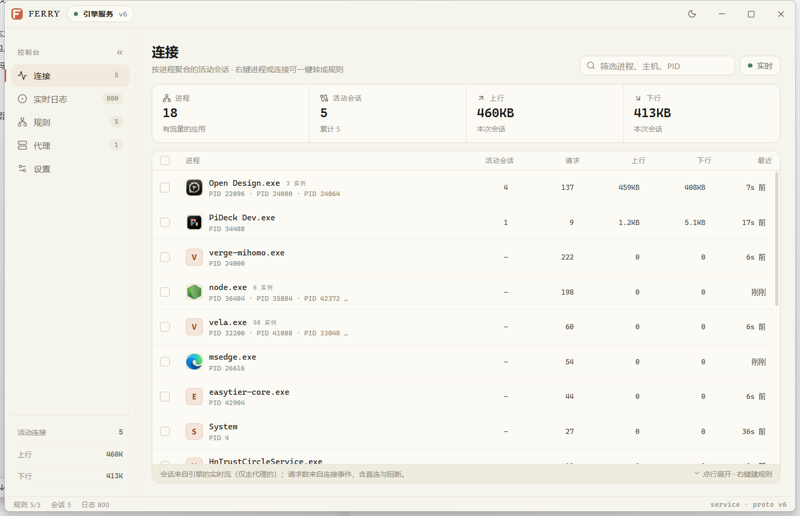

# Ferry

> 渡船：把流量从这一岸送到另一岸。源码目录与 Go 模块统一使用 Ferry 命名，
> 旧版 PBDeck 的配置会在首次启动时自动迁移。

[](https://github.com/ayuayue/ferry/actions/workflows/release.yml)



按进程分流的图形外壳，复用 [InterceptSuite/ProxyBridge](https://github.com/InterceptSuite/ProxyBridge)
的内核，用 [mygo](https://github.com/egoist/mygo)（Go + 系统 WebView）重写界面。
支持 **Windows x64**（4.3.0 内核，WinDivert）与 **Linux x64**（4.0.0 内核，eBPF）。

```
┌────────────────────────────┐
│ React 界面（本仓库 src/）    │
└─────────────┬──────────────┘
              │ mygo 绑定（同进程调用）
┌─────────────▼──────────────┐
│ Go 层 internal/session      │  规则/代理的真源，重放、事件缓冲、1s 轮询
└─────────────┬──────────────┘
              │ Windows：\\.\pipe\ProxyBridgeCtl / ProxyBridgeEvt（协议 v6）
              │ Linux  ：/run/proxybridge/ctl.sock（IPC v1）
┌─────────────▼──────────────┐
│ ProxyBridgeSvc / ferry-engine.service │  未修改的上游引擎，提权、持有驱动
└─────────────┬──────────────┘
              │
        ProxyBridgeCore.dll + WinDivert ／ libproxybridge + eBPF
```

之所以这么拆：上游 7.6k 行 C 引擎负责抓包/转发，服务与界面之间本来就有进程间通信，
所以换壳不需要碰内核，也不需要重新签名驱动。Ferry 只做三件事：把规则重放进去、
把事件/连接表读出来、把交互做得顺手。

## 功能

- **连接**（按进程聚合）：每个应用的实例数、活动会话、请求数、上下行、最近活动；
  点行展开该进程的每条代理会话（目标、端口、命中规则、代理、流量、年龄）。
- **实时日志**：引擎回调的每一次新建连接（含直连与阻断），可按进程或域名归组，
  可按动作筛选、搜索、跟随；40px 虚拟化列表，几千条也不卡。
- **右键一键建规则**：连接、会话、日志、分组行都能右键 —— 仅此主机 / 整进程 /
  `*.域名` / 让主机直连 / 阻断主机 / 复制主机名。新规则插到命中规则之前，完全
  相同的规则自动合并；连接页支持多选批量生成。
- **规则**：拖动排序（立即下发）、多选批量删除、启用/禁用、编辑、搜索。
- **代理**：HTTP / SOCKS5 配置，流式测试输出（解析、TCP 连接、隧道、请求）。
- **选择正在运行的应用**：按名称/路径/PID 搜索，显示实例数、PID 与真实图标。
- **托盘与自启**：关闭窗口收进托盘，单击托盘恢复；设置页可开机自启（登录后静默启动）。
- **亮/暗主题**：默认亮色，跟随按钮切换，选择会持久化。
- **服务安装**：安装器会注册随包的引擎（Windows 只提升安装助手的权限；Linux 通过 pkexec/sudo 装成独立的 `ferry-engine.service`），设置页也可重装；显示服务状态、引擎文件完整性、数据路径；未安装时界面给出引导，而不是假数据。
- **官方实例冲突保护**：按官方安装记录与进程完整路径识别。官方 GUI、CLI 或引擎正在运行时拒绝启动，也不会替换其服务；停止后可正常安装。Ferry 自己的引擎不会误报。
- **发布产物**：GitHub Actions 在 `windows-latest` 与 `ubuntu-latest` 分别构建 Windows 安装器 + 便携 ZIP、Linux `.deb` + `.tar.gz`，推送 `v*.*.*` 标签时上传 Release；任一平台缺产物就不发布。

## 开发

```sh
npm install
npx mygo generate     # 生成 src/mygo.ts
npm run dev           # mygo dev：Go 与前端一起热更新
```

没有安装引擎服务时，应用会停在「未连接」引导页并提供「安装引擎服务 / 重试连接」，
不会用演示数据冒充真实流量。要真正拦截流量必须安装服务（管理员 + WinDivert）。

```sh
npm run build         # tsc + vite + go build + NSIS 安装包
```

产物在 `build/windows-amd64/`：`Ferry.exe`、`engine/win/amd64/`（四个引擎文件）与
`ferry-setup-1.1.0-amd64.exe`。安装器会检查系统 WebView2；缺失时提供微软官方下载入口，
不会假装已附带运行库。便携 ZIP 必须完整解压，不能只复制 exe。

```sh
npx mygo build -platform linux/amd64     # 产物在 build/linux-amd64/
bash scripts/package-linux.sh            # 生成 .deb 与 .tar.gz（裁掉 Windows 资源、补 /usr/bin 与图标）
```

Linux 需要 `libgtk-3-0` 与 `libwebkit2gtk-4.1-0`；首次使用要在设置页装一次引擎
（或 `sudo ferry --install-engine`）。单元内容、权限模型与排障见 [docs/linux.md](docs/linux.md)。

## 目录

| 路径 | 用途 |
|---|---|
| `main.go` | mygo 窗口、托盘、绑定给前端的 API、引擎目录解析、提权安装入口 |
| `internal/pbproto/` | 协议编解码与客户端：`client_windows.go` 命名管道（v6）、`client_linux.go` Unix 套接字（IPC v1） |
| `internal/session/` | 连接生命周期、规则重放、事件环形缓冲、流轮询、右键建规则 |
| `internal/model/` | 应用侧持久化（`%AppData%\Ferry\settings.json` / `~/.config/ferry/settings.json`） |
| `internal/svc/` | 服务查询与安装/卸载、官方实例冲突识别；Windows 用 SCM + UAC，Linux 用 systemd + pkexec |
| `internal/procattr/` | 进程枚举（Windows 含 exe 图标转 PNG，Linux 读 `/proc`） |
| `src/` | React 界面（连接 / 实时日志 / 规则 / 代理 / 设置） |
| `resources/engine/win/amd64/` | Windows 引擎（上游 4.3.0，MIT，见同目录 LICENSE） |
| `resources/engine/linux/amd64/` | Linux 引擎（上游 4.0.0，MIT，见同目录 LICENSE） |
| `scripts/package-linux.sh` | 裁资源、装 `/usr/bin` 与图标、生成 deb 与 tar.gz |
| `docs/protocol.md` | Windows 管道协议与安装步骤备忘 |
| `docs/linux.md` | Linux 单元、权限模型、平台差异与排障 |

## 限制

- 引擎只把**走代理**的流放进连接表；直连/阻断的连接只出现在日志里。
- 日志事件只带目标 IP；域名列在有对应会话时补全，否则显示 IP。
- 域名规则依赖明文 DNS 嗅探，DoH/DoT 场景只按 IP 命中。

### Windows

- 引擎依赖 WinDivert 与服务，只有 x64 版本。
- UDP 仅在代理类型为 SOCKS5 时转发，HTTP 配置下的 UDP 会被引擎回退为直连。
- 服务名固定为 `ProxyBridgeSvc`；官方实例正在运行时 Ferry 会退出，停止后才允许替换服务。
- 只有安装/卸载服务的小助手需要管理员，正常 Ferry 不需要。

### Linux

- 需要 eBPF：内核 ≥ 5.11、BTF、cgroup v2；只有 x64 版本。
- 引擎不回报「这条会话命中了哪条规则」，连接页该列显示 `—`。
- HTTP 代理不承载 UDP，这类规则的 UDP 部分回退直连（SOCKS5 正常）。
- 存活极短的进程可能只留下 `pid <n>` 占位名；Ferry 会尝试用 `/proc` 补回。
- 托盘图标需要 `libayatana-appindicator3`，缺失时不建托盘，主窗口照常工作。
- 中文显示依赖系统字体，精简系统需装 `fonts-noto-cjk`（deb 已列为 `Recommends`）。

## 许可

Ferry 自有代码以 [MIT](LICENSE) 发布，不替代各第三方组件原有的许可。

随包的 ProxyBridge 4.3.0（Windows）与 4.0.0（Linux）均为 MIT，原始许可保存在各自
引擎目录的 `LICENSE.ProxyBridge.txt`。Windows 引擎内的 WinDivert 2.2.2 DLL/驱动
单独按照上游的 LGPL-3.0-or-later 选项再分发，原始许可（含可选的 GPL-2.0 文本）
保存在 `LICENSE.WinDivert.txt`；选择 LGPL 不会把 Ferry 自有源码变成 GPL。
Linux 引擎不包含 WinDivert。

完整来源、版本、对应源码入口与运行时声明随应用放在
[resources/THIRD_PARTY_NOTICES.md](resources/THIRD_PARTY_NOTICES.md)，
各依赖的原始许可在 [resources/licenses/](resources/licenses/) 下。

便携包中的 `THIRD_PARTY_NOTICES.md` 位于程序根目录，完整许可文本在其同级的
`licenses/` 目录；引擎许可则位于 `engine/<平台>/<架构>/`。上面链接指向它们的可编辑源文件。
